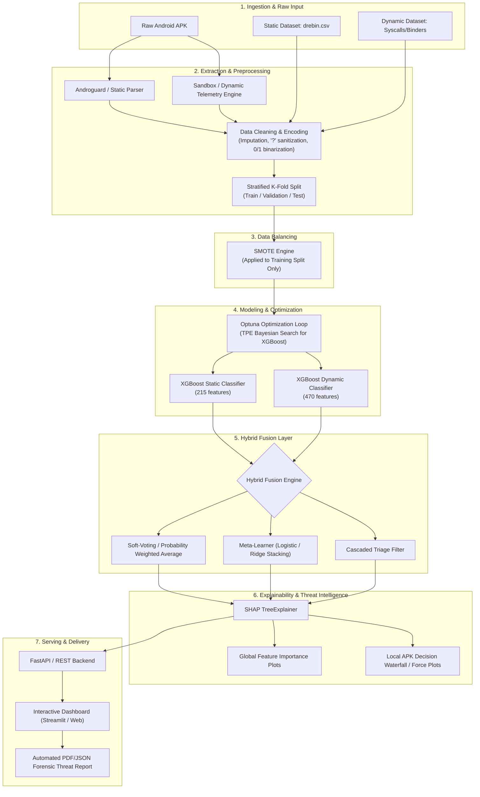

# Hybrid Android APK Intrusion Detection System (HIDS)
## Architecture, Workflow, Requirements, and Tooling Blueprint

---

### 1. Executive Summary & Core Concept

Android malware has evolved past simple signature matching. Modern threat actors leverage **code obfuscation, reflection, dynamic class loading (`DexClassLoader`), packing, and evasion techniques** to bypass traditional static antivirus scanners. Conversely, dynamic analysis in an isolated sandbox can fail when malware detects virtualization or delays execution via logic bombs.

This **Hybrid Intrusion Detection System (HIDS)** combines:
1. **Static Analysis (Compile-time inspection)** via [drebin.csv](file:///c:/ids/dataset/drebin.csv): Permissions, API calls, intents, cryptographic components, and service triggers without executing code.
2. **Dynamic Analysis (Runtime telemetry)** via [feature_vectors_syscallsbinders_frequency_5_Cat.csv](file:///c:/ids/dataset/feature_vectors_syscallsbinders_frequency_5_Cat.csv): Operating system kernel syscalls, IPC Binder transactions, and runtime access frequencies.
3. **Machine Learning Core**: **XGBoost** (Extreme Gradient Boosting) optimized via **Optuna** (Bayesian Hyperparameter Search).
4. **Data Balancing**: **SMOTE** (Synthetic Minority Over-sampling Technique) to eliminate class imbalance and prevent model bias toward majority classes.
5. **Explainability & Threat Attribution**: **SHAP** (SHapley Additive exPlanations via `TreeExplainer`) providing actionable attribution for SOC (Security Operations Center) analysts.

---

### 2. High-Level System Architecture



---

### 3. Subsystem Breakdown

#### Subsystem A: Data Ingestion & Sanitization
* **Static Dataset ([drebin.csv](file:///c:/ids/dataset/drebin.csv))**:
  * **Dimensions**: 7,255 samples × 216 columns.
  * **Features**: 215 binary static indicators (Android permissions such as `SEND_SMS`, `READ_PHONE_STATE`, sensitive API calls like `getDeviceId`, `Ljava.lang.Class.forName`, and broadcast receivers).
  * **Target**: `class` (S = Suspicious/Malware [5,560], B = Benign [1,694], 1 missing row).
  * **Anomalies Detected**: Column `TelephonyManager.getSimCountryIso` contains non-numeric `?` strings; 38 null entries requiring imputation/cleaning.
* **Dynamic Dataset ([feature_vectors_syscallsbinders_frequency_5_Cat.csv](file:///c:/ids/dataset/feature_vectors_syscallsbinders_frequency_5_Cat.csv))**:
  * **Dimensions**: 11,598 samples × 471 columns.
  * **Features**: 470 numerical runtime frequency counters (system calls such as `sysinfo`, `ioctl`, `fork`, `execve`, `ptrace`; binder interactions such as `sendMultipartText`, `getSubscriberId`, file system access patterns `FS_ACCESS`, `NETWORK_ACCESS`).
  * **Target**: `Class` (5 discrete categories: 1: 1,253, 2: 2,100, 3: 3,904, 4: 2,546, 5: 1,795).
  * **Zero Missing Values**: Pure integer frequency matrix.

#### Subsystem B: Class Balancing Engine (SMOTE)
* **Objective**: Synthetic Minority Over-sampling Technique (SMOTE) generates synthetic samples along the feature space line segments joining $k$-nearest neighbors of the minority class.
* **Leakage-Free Execution Rule**: SMOTE is fitted **strictly on the training partition** inside cross-validation folds. It must never touch validation or test sets to ensure realistic evaluation metrics.
* **Variant Strategy**: Standard SMOTE, Borderline-SMOTE (synthesizes samples along decision boundaries where ambiguity is highest), or ADASYN.

#### Subsystem C: Dual-Engine XGBoost & Hybrid Fusion Strategies
We deploy three viable fusion paradigms:
1. **Late Fusion / Soft-Voting Ensemble (Recommended for benchmark decoupling)**:
   * Engine 1 outputs $P(\text{Malicious} \mid X_{\text{static}})$.
   * Engine 2 outputs $P(\text{Category}_k \mid X_{\text{dynamic}})$ mapped to binary malware likelihood or granular multi-class categorization.
   * Fusion score: $P_{\text{Hybrid}} = w_1 \cdot P_{\text{Static}} + w_2 \cdot P_{\text{Dynamic}}$, where weights $(w_1, w_2)$ are calibrated via validation ROC-AUC.
2. **Stacking Meta-Classifier**:
   * Out-of-fold probability predictions from both static and dynamic XGBoost models serve as inputs to a second-stage meta-learner (Logistic Regression or Shallow LightGBM).
3. **Hierarchical / Cascaded Triage**:
   * Stage 1: Fast static filter (sub-second evaluation of permissions and manifest structure). High-confidence benign or malicious samples are classified immediately.
   * Stage 2: Ambiguous or borderline samples ($0.35 \le P_{\text{Static}} \le 0.75$) are routed to the dynamic execution sandbox for deep syscall analysis.

#### Subsystem D: Hyperparameter Optimization (Optuna)
* **Optimization Framework**: Tree-structured Parzen Estimator (TPE) algorithm running 50–100 trials with stratified 5-fold cross-validation.
* **Search Parameter Space**:
  * `learning_rate`: $0.01 - 0.2$ (log-scale)
  * `max_depth`: $3 - 10$
  * `n_estimators`: $100 - 800$
  * `subsample`: $0.6 - 1.0$
  * `colsample_bytree`: $0.5 - 1.0$
  * `min_child_weight`: $1 - 10$
  * `gamma`: $0.0 - 5.0$
  * `reg_alpha` (L1) & `reg_lambda` (L2): $10^{-3} - 10.0$
* **Objective Metric**: Stratified F1-Score or PR-AUC (Precision-Recall Area Under Curve) to prioritize low False Positive Rates (FPR).

#### Subsystem E: Explainable AI & Threat Attribution (SHAP)
* **Engine**: `shap.TreeExplainer` optimized for XGBoost decision trees.
* **Global Interpretability**:
  * Summary beeswarm plots demonstrating which permissions (`SEND_SMS`, `READ_PHONE_STATE`) and syscall frequencies (`ioctl`, `sysinfo`, `Binder transactions`) dominate threat scores across the entire corpus.
* **Local Threat Attribution (Per-APK Forensic Breakdown)**:
  * Force and Waterfall plots explaining individual APK verdicts.
  * E.g.: *"APK tagged as Malicious (Probability 96.4%) due to combination of: (1) Requested `SEND_SMS` (+0.32 SHAP), (2) Dynamic SMS binder call count > 12 (+0.28 SHAP), (3) `SYSTEM_ALERT_WINDOW` permission (+0.18 SHAP)."*

---

### 4. End-to-End Workflow

```
[Phase 1: Exploratory Data Analysis & Sanitization]
  ├── Load drebin.csv & dynamic frequency CSV
  ├── Clean '?' in TelephonyManager, drop 1 corrupt row, cast to uint8
  └── Analyze class balances and feature variance
         │
[Phase 2: Stratified Partitioning & SMOTE]
  ├── Stratified 80/20 Train-Test split
  ├── Optional 5-Fold Stratified K-Fold setup
  └── Apply SMOTE / Borderline-SMOTE exclusively on Train splits
         │
[Phase 3: Hyperparameter Optimization with Optuna]
  ├── Define objective function evaluating Stratified F1 / ROC-AUC
  ├── Run TPE sampler with early pruning (MedianPruner)
  └── Persist optimal parameters to config/best_params.json
         │
[Phase 4: Model Training & Evaluation]
  ├── Train optimized Static XGBoost Model
  ├── Train optimized Dynamic XGBoost Model
  ├── Build Stacking / Soft-Voting Fusion Model
  └── Generate Confusion Matrix, ROC-AUC, PR-AUC, Precision, Recall, F1
         │
[Phase 5: SHAP Interpretability Pipeline]
  ├── Compute TreeExplainer values on test sets
  ├── Export Global Summary Beeswarm & Bar Plots
  └── Generate single-sample local waterfall explanation function
         │
[Phase 6: Live APK Extraction Bridge (Production Readiness)]
  ├── Androguard parser mapping raw .apk to 215 Drebin features
  ├── Telemetry emulator logger mapping runtime syscalls to 470 features
  └── Unified inference engine returning verdict + SHAP explanation
```

---

### 5. Requirements & Tooling Matrix

| Category | Component / Tool | Version | Purpose in this System |
| :--- | :--- | :--- | :--- |
| **Language** | Python | `>= 3.10` | Core implementation runtime |
| **Machine Learning** | `xgboost` | `2.1.0` (Installed) | Primary gradient boosting tree classifier |
| **Optimization** | `optuna` | `>= 3.6.0` | Bayesian optimization of hyperparameters |
| **Data Resampling** | `imbalanced-learn` | `0.14.2` (Installed) | SMOTE / Borderline-SMOTE implementation |
| **Explainable AI** | `shap` | `0.52.0` (Installed) | TreeExplainer for feature attribution |
| **Data Processing** | `pandas`, `numpy` | `2.2.2`, `2.5.2` (Installed) | DataFrame manipulation and matrix operations |
| **ML Utilities** | `scikit-learn` | `1.5.0` (Installed) | Cross-validation, metrics, scalers, encoders |
| **APK Disassembly** | `androguard` | `4.1.4` (Installed) | Real-time APK manifest and DEX static extractor |
| **Visualization** | `matplotlib`, `seaborn` | `3.11.2`, `0.13.2` (Installed) | Evaluation curves, confusion matrices, SHAP plots |
| **Serving (Optional)**| `fastapi`, `uvicorn` | `0.141.1`, `0.54.0` (Installed)| High-performance REST API for live APK scanning |
| **UI Dashboard** | `streamlit` or Web UI | Latest | Security analyst interactive portal |

---

### 6. Hardware & Performance Guidelines

* **RAM**: 16 GB recommended (SHAP TreeExplainer pre-computations on 11k+ dynamic rows benefit from available memory).
* **CPU**: Multi-core (8+ threads recommended) to parallelize Optuna trials (`n_jobs=-1`) and XGBoost tree construction (`n_jobs=-1`).
* **Storage**: Fast SSD for caching extracted APK artifacts and model serialization (`.joblib` / `.json`).
